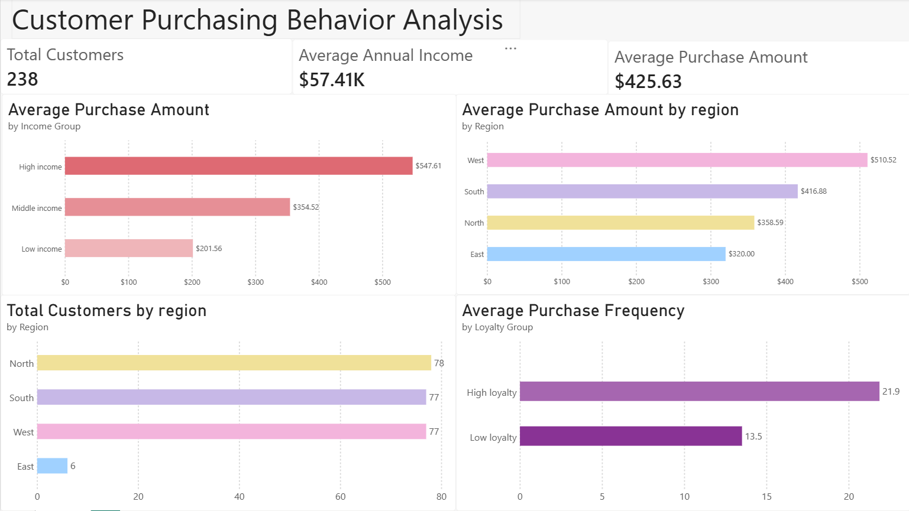

# Customer Purchasing Behavior Analysis

## Project Overview

This project explores customer purchasing behavior using SQL and Power BI, focusing on how income, age, loyalty scores, and geographical location relate to purchase amounts and frequency.

The goal is to identify patterns in customer behavior and present the findings through a clear, interactive dashboard.

## Tools Used

- **SQL (SQLite)** — Data exploration, calculations, and customer segmentation
- **Power BI** — Data visualization and dashboard creation
- **Python** — Importing the CSV dataset into SQLite
- **VS Code** — Writing and running SQL queries

## Dataset

**Source:** [Customer Purchasing Behaviors — Kaggle](https://www.kaggle.com/datasets/hanaksoy/customer-purchasing-behaviors)

**License:** CC0 (Public Domain)

The dataset contains 238 customer records and 7 columns, including age, annual income, purchase amount, loyalty score, region, and purchase frequency.

## Data Exploration

Initial data quality checks included missing values, duplicate customer IDs, and negative numerical values.

The SQL analysis focused on:

- Customer income and purchasing behavior across age groups
- Average purchase amounts across income categories
- Relationships between loyalty scores and purchase frequency
- Regional differences in customer behavior
- Customer segmentation based on purchasing frequency

## Key Findings

**1. Income and Purchasing Behavior**

Customers in the highest-income group have the highest average purchase amount ($547.61) and purchase frequency (23.64).

**2. Regional Differences**

The West region has the highest average purchase amount ($510.52). North, South, and West have similar customer counts, while the East region has only six customers.

**3. Customer Loyalty**

Customers with loyalty scores above 5 have a higher average purchase frequency (21.9) compared to customers with scores of 5 or below (13.5).

**4. Purchase Frequency**

The West region has the largest number of high-frequency customers, while the South region has the most customers in the medium-frequency group.

## Power BI Dashboard

An interactive Power BI dashboard presents the main findings, including customer demographics, purchasing behavior, regional differences, and loyalty patterns.

[View Power BI dashboard file](dashboard/dashboard.pbix)

## Conclusion

The analysis shows a positive association between annual income and purchasing behavior. Customers with higher loyalty scores also tend to purchase more frequently.

These findings suggest potential opportunities for customer retention and targeted marketing campaigns.

However, the dataset is relatively small, and its original real-world provenance has not been verified. The results should therefore be treated as exploratory.

## Project Files

- `sql/analysis.sql` — SQL queries and findings
- `dashboard/dashboard.pbix` — Interactive Power BI dashboard
- `dashboard/dashboard.png` — Dashboard preview
- `data/Customer Purchasing Behaviors.csv` — Original dataset
- `setup_database.py` — Python script for creating the SQLite database
